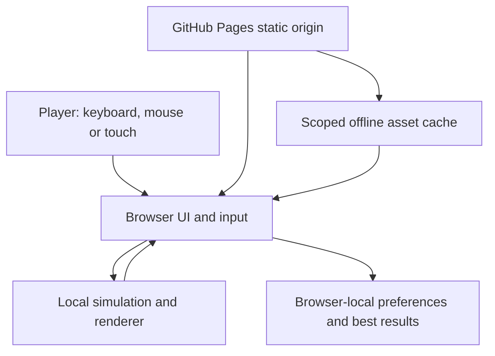

# Architecture and security boundary

Status: first browser release. The Operator authorised implementation, main-branch publication and public GitHub Pages hosting on 5 November 2026. This supersedes the attached discovery export's generic instruction to await approval.

## Decision: static, local-first FPS

The confirmed platform is a browser link, primarily Windows desktop with mobile support and occasional offline use. Multiplayer is explicitly later work. A self-contained HTML/CSS/JavaScript application served by GitHub Pages is the smallest architecture that delivers that outcome without hosting costs, accounts or a persistent backend. Game code is intentionally public; there is no confidential strategy or customer dataset.

The product is an original stylised parody. Shipped geometry, sounds, marks and wording must be original project assets or assets with recorded redistribution rights. The reference title does not supply an asset licence.

All simulation is client-authoritative and suitable for solo play with bots. A future competitive multiplayer release needs a separate threat model and authoritative server; local results are not trustworthy competitive records.

## Data model and retention

Runtime state comprises player position, health, loadout/ammunition, bots, objective state and match results. Runtime state is disposable. Only the preferences and local best results actually implemented may persist in browser storage. No identity, account, location, contact information or telemetry is required. Storage denial must leave a usable session; clearing the site's browser data resets local persistence and offline availability. There is no migration/import requirement or remote database to back up.

## Interfaces and failure behaviour

The browser loads same-origin relative assets so project-subpath GitHub Pages deployment works. Input flows to simulation and renderer in the same process; there is no external game API. Audio starts only after a player gesture. Pointer-lock refusal must not trap the player; pause/resume and touch controls must remain understandable. Tab hiding, focus loss and pause must stop simulation/input progression and prevent stuck firing or movement. A cached app can operate after a successful online load; first-ever offline access cannot be promised.

## Security and privacy controls

- No secrets, credentials, privileged endpoints, remote analytics or user-generated HTML are needed.
- Keep service-worker control and cache matching inside the project scope; cleanup must target this app's own cache names, never other sites/projects sharing the origin.
- Prefer a complete versioned asset cache; a failed installation must retain the previous working version.
- Serve active assets from the same origin. Avoid runtime CDN dependencies so the offline claim is meaningful and third parties receive no gameplay requests.
- Restrict CI permissions to the release job's actual needs. Changes to Pages workflows require review because workflows can receive repository permissions.
- Public exposure permits source copying and local score manipulation; neither creates server access because none exists. Do not present a local leaderboard as tamper-resistant.

This document defines controls, not an unqualified security certification. QA must bind source inspection and execution evidence to the actual candidate. Public-host availability, browser vulnerabilities, account/organisation settings and physical phone performance are outside source-only verification.

## Deployment and recovery

Publish repository-owned static assets to GitHub Pages using relative URLs. Keep source changes on main under the user's explicit authorisation. Record the release revision and verify the public URL after deployment. Roll back source through a normal revert and redeploy; bump the offline cache version when shipping changed executable assets. Old browser tabs may continue their loaded version until reload. Never silently describe a committed build as live until the public deployment is observed.

## Deliberate limits

This release is a solo arena FPS with bots, not a feature-equivalent recreation of an AAA game. It does not promise online multiplayer, thousands of concurrent players, cross-device saves, accounts or guaranteed support for every browser/graphics stack. Native phone and real Windows playtesting remain required human acceptance evidence where the execution environment cannot provide it.

## 0.2.0 visual/gameplay pass

Retains dependency-free Canvas raycasting. Detailed models are original procedural 2D perspective drawings and cached directional sprites, not imported 3D meshes. Materials are generated once and retained; soldier cache is bounded. Graphics setting selects internal rendering resolution and floor sampling; portrait internal height is capped at 1280. Aim changes accuracy/FOV and aligns the illustrated sight. This remains a retro FPS: no stacked floors or 3D physics; the 0.4.0 pass below adds vertical aim hit alignment. Evaluate a proper WebGL engine for that future scope. Cached BFS navigation invalidates only when cover changes. Controller settings are optional local storage with malformed-value recovery.

## 0.3.0 polish and recovery

The controller uses 1/120-second simulation steps with at most 100ms catch-up per rendered frame; hidden-tab/pause resets clear the accumulator. Rendering remains independent. HUD text changes are cached, normal HUD work is capped at 20Hz and minimap at 10Hz; menu/paused backgrounds render at 30Hz. Audio noise buffers are reused and transient nodes disconnect after playback. The Canvas output preserves aspect at up to 1920x1080; the internal renderer has quality-specific pixel budgets in portrait and landscape.

Held automatic fire retains fractional cooldown for stable cadence; tapping the trigger interrupts sprint. Bot navigation seeds the open objective area so one central barricade cannot invalidate all paths, and soft separation reduces squad overlap without blocking player movement. Match-local shot/hit counters exclude grenades and rejected shots. Recent-shot and incoming-damage effects retain one record each; tracer work and sprite/shell lifetimes remain bounded.

Input mode follows the active pointer, preserving mouse use on touchscreen laptops. Each touch action has independent ownership and lost-capture recovery. Pause makes the background inert, contains keyboard focus, clears inputs and supports Escape to resume; Tab during play opens pause. Reduced motion suppresses optional flashing/moving effects but retains HP, static kill text and directional threat information. Full-forward touch movement requests sprint.

PNG installation icons are rasterizations of the original project WD SVG, padded for maskable launchers. The worker precaches them with the complete v8 bundle. Build/CI browser tools are isolated from the application artifact. No server, telemetry, remote assets or account surface was introduced.

## 0.4.0 combat feel

Mouse button state is tracked with mousedown/up as well as pointer capture: Pointer Events do not emit a fresh pointerdown for the second button of a mouse chord. Aim and primary fire therefore remain independent in both press/release orders. Touch-generated compatibility mouse events are ignored. Aim input updates immediately; the controller converts look deltas to angular player.pitch and yaw with current optical magnification sensitivity scaling.

The renderer uses cameraView focal magnification (4x marksman, 1.45x carbine, 1.2x SMG), a genuine circular sniper optic/reticle and dedicated open/reflex ADS sights. Foreground receivers do not cover the aiming point. The horizon is centred from tan(player.pitch)*projection; direct shots must intersect the soldier's vertical body interval, and impact projection retains the shot pitch. This is still a 2.5D map with horizontal collision, not a full 3D terrain/physics engine.

ADS retains 80% of ordinary movement speed and a small moving accuracy penalty. Optional view bob/sway is suppressed in ADS. The controller interpolates display positions and bot headings between fixed simulation steps, keeping authoritative collision/hits separate and player look immediate. Teleports/death/respawn do not interpolate across the map. Stable display-object identity avoids resetting weapon animation every frame.

Bots retain targets until a materially closer threat arrives, commit navigation waypoints, steer velocity/heading continuously, and advance walking phase from distance travelled. A single procedural soldier silhouette articulates from continuous signed facing, with legs driven by travelled distance. It avoids overlapping directional sprites, extra offscreen canvases and sprite-cache growth. Static reduced-motion alternatives remain supported.
